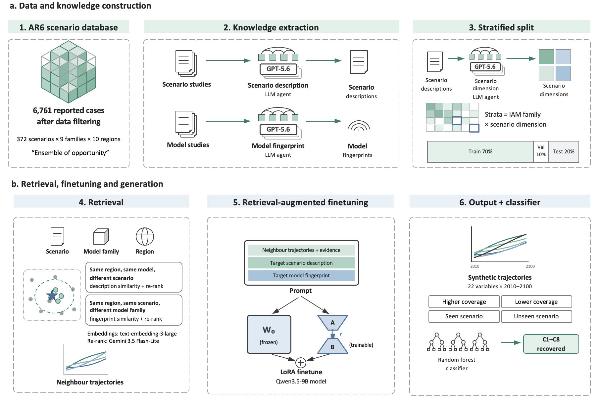

# Exploring energy pathways of climate mitigation scenarios with large language models

## Project Overview
This repository contains the code and source data of a knowledge-guided large language model (LLM) framework that generates synthetic energy system trajectories for specified IAM family–scenario combinations. The framework draws on the IPCC AR6 Scenarios Database (22 energy variables, ten R10 regions, 372 scenarios and 9 IAM families). LLM agents extract scenario descriptions and model fingerprints from the literature. For each target, the framework retrieves similar cases, and a finetuned open-weight LLM (Qwen3.5-9B) generates the trajectories.



## Environment Setup

### 1. Clone the Repository
```bash
git clone https://github.com/Peijin-Jiang/LLM_IAM
cd LLM_IAM
```

### 2. Install Dependencies
```bash
pip install -r requirements.txt
```
Finetuning and inference run on a GPU (see the notebooks in `finetune/`). The extraction, reranking and zero-shot RAG steps call the OpenAI and Gemini APIs (`OPENAI_API_KEY`, `GEMINI_API_KEY`).

### 3. Data Availability
The AR6 Scenarios Database is not redistributed here. The required data can be downloaded from IIASA (https://iiasa.ac.at/models-tools-data/ar6-scenario-explorer-and-database).

`outputs/` holds the test-set predictions of the four methods. These are synthetic trajectories, not output of the IAMs.

## Repository Structure

| Path | Purpose |
|---|---|
| `make_datasets/` | Dataset construction, and training, validation and test sets |
| `scenario_des/` | Scenario descriptions |
| `fingerprint/` | Model fingerprints |
| `policy_coverage_analysis/` | Design dimensions and coverage |
| `rag_core.py` and the ablation scripts | Neighbour retrieval, prompt template, zero-shot RAG baseline and ablations |
| `finetune/` | Finetuning and inference of Qwen3.5-9B |
| `knn/`, `cvae/` | Baseline models |
| `classifier/` | Climate category classifiers |
| `outputs/` | Test-set predictions of the four methods |
| `results/` | Figure scripts and source data |

The steps to reproduce the analysis are listed in `WORKFLOW.md`.
